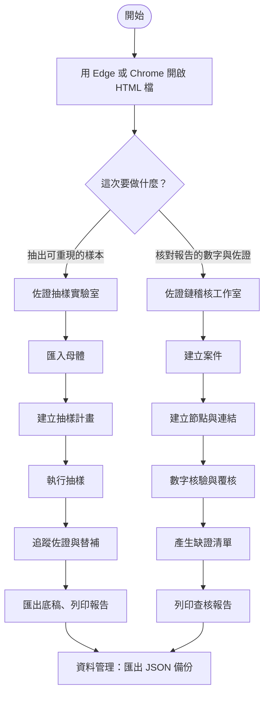
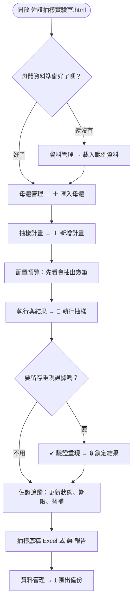
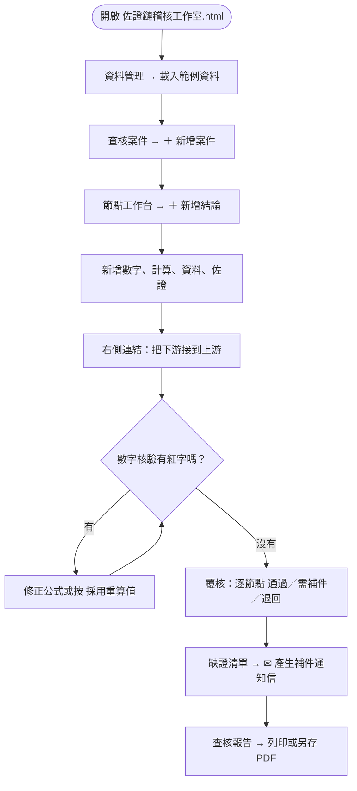
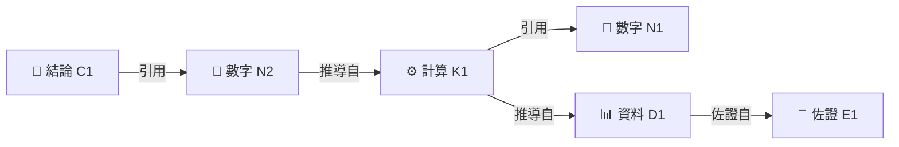

# 佐證工具箱 使用手冊

這是兩個**單一 HTML 檔、離線可用**的查核輔助工具，給需要「抽樣要能重現」與「報告數字要能追溯」的查核、覆核人員使用。不需要安裝、不需要網路、不需要帳號，資料只存在你自己的瀏覽器裡。

| 工具 | 檔案 | 解決的問題 |
|---|---|---|
| 佐證抽樣實驗室 | `佐證抽樣實驗室.html` | 從母體抽出可重現、可說明的樣本，並追蹤佐證調閱與替補 |
| 佐證鏈稽核工作室 | `佐證鏈稽核工作室.html` | 把「結論 → 數字 → 計算 → 資料 → 佐證」串成鏈，找出沒有來源的數字與算不平的計算 |

**前提**：使用 Microsoft Edge 或 Google Chrome（最新版），並在**一般視窗**操作（無痕模式會讓資料無法保存）。

## 目錄

- [這是什麼](#這是什麼)
- [五分鐘上手](#五分鐘上手)
- [整體使用流程](#整體使用流程)
- [工具一 佐證抽樣實驗室](#工具一-佐證抽樣實驗室)
- [工具二 佐證鏈稽核工作室](#工具二-佐證鏈稽核工作室)
- [隱私與資料安全](#隱私與資料安全)
- [常見問題與排錯](#常見問題與排錯)
- [維護者說明](#維護者說明)
- [檔案結構](#檔案結構)

## 這是什麼

兩個工具解決的是同一件事的不同半段：

- **抽樣**：母體貼進來 → 用固定種子抽出樣本 → 每一筆都記錄「為什麼被抽中」→ 母體與執行各有指紋，事後可以證明「同一份母體、同一組參數，會抽出同一組樣本」。
- **佐證鏈**：報告上的結論與數字 → 拆成節點並互相連結 → 自動檢查哪些數字沒有來源、哪些計算和宣稱值不符、哪些結論沒有佐證 → 產出缺證清單與查核報告。

兩個工具**各自獨立**：資料庫不同、互不相通，也不會互相匯入。

## 五分鐘上手

1. 把整個資料夾放在本機硬碟（例如 `D:\查核工具`）。
2. 雙擊 `佐證抽樣實驗室.html` 或 `佐證鏈稽核工作室.html`，瀏覽器會直接開啟。
3. 第一次開啟時是空的，先到左側選單「系統」區的 **💾 資料管理**，按 **載入範例資料**。
4. 依左側選單由上往下操作（總覽 → 母體管理／查核案件 → …）。
5. 做完一個階段就按右上角 **⤓ 匯出**，把 JSON 備份存到安全位置。

> 匯出的備份檔名是 `<工具名稱>_全部備份_<YYYYMMDD>.json`，內含完整資料（含附件）。換電腦或重裝時，用 **資料管理 → 還原備份（清空後匯入）** 還原。

## 整體使用流程



## 工具一 佐證抽樣實驗室

### 快速開始



實際操作步驟：

1. **匯入母體**：母體管理 → **＋ 匯入母體**，填母體名稱（必填）、期別、資料來源說明，貼上 Excel 表格或選 CSV／TSV 檔。
2. **確認欄位對應**：系統會自動猜測「鍵值、金額、分層、單位、風險」對應欄位；**鍵值與金額是必對應欄位**，對錯要手動改。
3. **建立計畫**：抽樣計畫 → **＋ 新增計畫**，選方法、輸入樣本數 `n`、預備數 `m`，按 **🎲 產生** 取得種子。
4. **先預覽**：在計畫列按 **配置預覽**，看正選／全查／預備筆數、說明與警告，不必真的抽。
5. **執行**：按 **🎲 執行抽樣**（或計畫列的 **▶ 執行**）。同一個計畫若用相同種子再執行，系統會提醒「會得到相同樣本」。
6. **驗證與鎖定**：結果頁按 **✔ 驗證重現** 確認三項比對通過，再按 **🔒 鎖定結果**，鎖定後不可刪除。
7. **追蹤**：到佐證追蹤更新每一筆狀態與期限，必要時做替補。
8. **交付**：按 **抽樣底稿 Excel**（5 張工作表）或 **🖨 報告**（A4 列印）。

### 頁面與操作

| 選單 | 頁面 | 可以做什麼 |
|---|---|---|
| 工作台 | 📊 總覽 | 統計卡、樣本狀態長條圖、近期 8 次抽樣、逾期未取得提醒 |
| 工作台 | 🗂️ 母體管理 | ＋ 匯入母體、**選用**、**重新匯入**、🗑 刪除；摘要與分層統計、母體明細 |
| 工作台 | 🧮 抽樣計畫 | ＋ 新增計畫、配置預覽、▶ 執行、✎ 編輯、🗑 刪除；下方有屬性抽樣與 MUS 樣本數試算 |
| 工作台 | 🎲 執行與結果 | 🎲 執行抽樣、✔ 驗證重現、🔒 鎖定結果、樣本清單 CSV、抽樣底稿 Excel、🖨 報告 |
| 工作台 | 🗺️ 覆蓋地圖 | 分層 × 單位（或風險）熱力圖，筆數或金額涵蓋率；紅框＝高風險但沒有任何有效樣本 |
| 工作台 | 📎 佐證追蹤 | 更新狀態與結果、上傳附件、替補、批次設定勾選項目、各種篩選 |
| 系統 | 💾 資料管理 | 匯出備份、⤒ 匯入 JSON（合併）、還原備份（清空後匯入）、載入範例資料、清除全部資料、儲存空間 |
| 系統 | 📖 使用說明 | 方法說明、FAQ、修正紀錄 |

右上角工具列固定三顆：**⤒ 匯入**（JSON 備份合併）、**⤓ 匯出**（全部備份）、**🖨 報告**（未選抽樣時，自動用目前母體最近一次抽樣）。

清單類表格都支援全文搜尋、點欄位排序、CSV／Excel 匯出（匯出的是**目前篩選與排序後的全部列**，不是只有畫面上那 200 列）。

### 六種抽樣方法

| 方法 | 名稱 | 適合情境 |
|---|---|---|
| 簡單隨機 `srs` | 洗牌後取前 n 筆 | 一般無分層資料 |
| 系統抽樣 `sys` | 固定間距 k 取樣，隨機起點 | 母體有序、要平均散佈 |
| 分層抽樣 `strat` | 依比例、等額或 Neyman 配置 | 已分層且需各層都抽到 |
| 金額單位抽樣 `mus` | 以金額為單位，大額自動全查 | 想讓大額項目優先被抽到 |
| 風險加權隨機 `risk` | 風險高者權重高、中籤機率大 | 已有風險等級欄位 |
| 高額全查＋其餘抽樣 `keyplus` | 超過門檻全查，其餘用指定方法抽 | 大額必須全看、其餘抽樣 |

分層抽樣可以設定「每層最低抽樣數」，總數可能因此大於 n（說明頁與畫面都有提示）。MUS 會反覆把「大於等於間距」的項目列為全查，直到沒有新的全查項目為止。

### 母體匯入與金額解析

- 來源只接受**貼上的表格（Tab 分隔）**或 **CSV／TSV 檔**；不直接讀 `.xlsx`（請先在 Excel 另存 CSV 或直接複製貼上）。
- 檔案會先以 UTF-8 讀取，失敗才改用 Big5。
- 金額可接受千分位、貨幣符號、全形數字、科學記號、括號負數、尾端負號：

| 輸入 | 解析結果 |
|---|---|
| `NT$ 1,000` | 1000 |
| `-$1,000`、`-NT$1,000`、`(1,000)`、`1,000-` | -1000 |
| `1.2E+6` | 1200000 |
| `１２３４`、`－１，０００` | 1234、-1000 |
| `abc`、空白 | 無法解析，以 0 計並提示筆數 |

- 重新匯入同一份母體時，若母體指紋改變，會先要求確認才覆蓋。

### 執行與驗證

- 預設調閱期限是**今天 + 14 天**，可留空；預備樣本不設期限，狀態為「備用」。
- **✔ 驗證重現**會比對三項：目前母體指紋是否等於執行時的指紋、用當時參數重抽的樣本序列是否完全相同、執行指紋是否一致。
- 母體指紋只涵蓋**鍵值與金額**。若有人改了分層、單位或風險欄位，第一項會通過但第二項會失敗，這是已知限制（說明頁有寫）。
- 鎖定後：該次抽樣不可刪除，所屬計畫也不可刪除；要刪所屬母體得先輸入「刪除」二字。

### 佐證追蹤與替補


- 單筆更新時，可在「待調閱／已取得／已查核／無法取得」之間自由切換；選「已查核」必須指定結果。
- 只有狀態為「無法取得」的樣本會出現 **替補** 按鈕。替補優先選同分層、再依序號；新樣本期限沿用原期限，原期限已過則為今天 + 7 天。
- **批次設定勾選項目**：可一次把勾選列改成「已取得／待調閱／無法取得」。已被篩選隱藏的勾選列不會被處理；已查核者會被清除結果，確認框會先告訴你要動幾筆。
- 篩選條件：全部、各狀態、異常、逾期（待調閱且期限已過）。
- 涵蓋率計算會排除「無法取得」與「已替補」，未啟用的預備樣本也不計入。

### 匯出格式

| 輸出 | 檔名格式 | 內容 |
|---|---|---|
| 樣本清單 CSV | `佐證抽樣實驗室_樣本清單_YYYYMMDD.csv` | 目前抽樣的全部樣本 |
| 抽樣底稿 Excel | `佐證抽樣實驗室_抽樣底稿_<計畫名>_YYYYMMDD.xls` | 計畫參數、正選樣本、預備樣本、覆蓋統計、替補紀錄（5 張工作表） |
| 清單匯出 | `佐證抽樣實驗室_<清單名>_YYYYMMDD.csv`／`.xls` | 畫面上該清單篩選後的全部列 |
| 列印報告 | 瀏覽器列印／另存 PDF | A4、邊界 14mm，含參數、指紋、方法說明、覆蓋地圖、樣本表與簽名欄 |
| JSON 備份 | `佐證抽樣實驗室_全部備份_YYYYMMDD.json` | 母體、明細、計畫、執行、樣本、附件（Base64） |

兩點要注意：

- CSV 以 UTF-8 BOM 輸出，並會把 `= + - @` 開頭的**文字**欄位前置 `'`，避免 Excel 當成公式執行。
- CSV 用 Excel 開啟時，前導 0 或超過 15 位的鍵值可能被轉成數字；要保留原樣請改用 Excel 匯出。

### 備份與還原

- **⤓ 匯出／資料管理 → 匯出**：下載完整 JSON，附件會轉成 Base64（檔案約為原附件 1.37 倍）。
- **⤒ 匯入 JSON（合併）**：同 id 覆蓋、其餘保留；適合把同事的資料併進來。
- **還原備份（清空後匯入）**：先清空六個資料 store 再整份寫入，適合換電腦或復原。
- 檔案不是本工具匯出的、或 store 格式不符時，會整份拒絕且不改動現有資料。
- **清除全部資料**會清空業務資料（保留介面設定），執行前有兩段確認。

## 工具二 佐證鏈稽核工作室

### 快速開始流程



想先看效果，最短路徑是：**資料管理 → 載入範例資料**，載入後會自動跳到「⭐ 佐證鏈地圖」，範例刻意留了幾個問題（無來源數字、算不平、空佐證、已退回）可以直接觀察。

### 十一頁功能

| 頁面 | 可以做什麼 |
|---|---|
| 總覽 | 案件數、節點數、鏈完整度、無來源數字、待覆核節點；提醒事項可點擊跳轉；各案件鏈完整度長條圖 |
| 查核案件 | ＋ 新增案件、✎ 編輯、⧉ 複製、🗑 刪除；搜尋、排序；CSV 與 Excel（全部）匯出 |
| 節點工作台 | 左：節點清單（類型篩選、搜尋、匯出）；中：明細、健康度問題、附件、覆核；右：上游／下游連結管理 |
| ⭐ 佐證鏈地圖 | SVG 分層圖；點節點會高亮上游與下游；斷鏈紅虛線＋✕、孤立節點虛線外框 |
| 數字核驗 | 宣稱值／重算值／差異／燈號；可一鍵「採用重算值」；下方有公式試算區 |
| 資料匯入 | 貼上 TSV 或匯入 CSV 建立資料集；預覽；由資料集欄位建立資料節點 |
| 覆核 | 依狀態篩選（含「需重新覆核」）、逐節點 通過／補件／退回；CSV 匯出 |
| 缺證清單 | 依規則篩選、預設嚴重在前；✉ 產生補件通知信並複製到剪貼簿 |
| 查核報告 | A4 預覽與列印（可另存 PDF） |
| 資料管理 | JSON 備份、合併匯入、還原、Excel 匯出（5 工作表）、預設容許誤差、載入範例資料、清除全部資料、儲存空間 |
| 使用說明 | 快速上手、健康度規則、公式語法、資料保存提醒 |

頂端固定有案件切換下拉選單與 **⤒ 匯入／⤓ 匯出／🖨 報告** 三個快捷鍵。

### 五種節點與連結

每個節點有代號：結論 `C`、數字 `N`、計算 `K`、資料 `D`、佐證 `E`（例如 `C1`、`N2`）。新增時自動編號，也會避開已被其他類型占用的代號。



- 連結方向一律是**下游 → 上游**：結論引用數字、數字推導自計算、計算引用數字或資料、任何節點佐證自附件。
- 三種關係：引用 `references`、推導自 `derived_from`、佐證自 `supported_by`。
- 計算節點存檔時，公式裡用到的 `{代號}` 會自動補上「引用」連結（不會自動刪掉舊連結）。
- 改代號時，同案件其他計算公式中的 `{舊代號}` 會一起改掉。
- **影響分析**：改動節點後可看有哪些下游受影響，已覆核通過的下游會被標成「需重新覆核」。

佐證節點可以上傳附件（單檔上限 **25 MB**），或填「參考路徑／文號／系統畫面」。超過 25 MB 會被拒收，請改填參考路徑。

### 健康度規則

系統會自動標記問題，嚴重等級會讓地圖出現紅框與紅色數字徽章：

| 規則 | 名稱 | 等級 | 觸發條件 |
|---|---|---|---|
| R0 | 結論無佐證鏈 | 嚴重 | 結論沒有任何路徑連到資料或佐證 |
| R1 | 無來源數字 | 嚴重 | 數字節點沒有任何上游連結 |
| R2 | 核驗不符 | 嚴重 | 重算值與宣稱值差異超過容許誤差，或公式無法計算 |
| R3 | 空佐證 | 注意 | 佐證沒有附件、也沒有參考路徑 |
| R4 | 孤立節點 | 注意 | 非結論節點沒有被任何結論引用 |
| R5 | 需重新覆核 | 注意 | 已通過覆核的節點，本身或任一上游之後被修改 |
| R6 | 循環引用 | 嚴重 | 節點經由連結又連回自己 |
| RV | 覆核退回／需補件 | 嚴重 | 覆核結果是退回或需補件 |

鏈完整度的定義：從每個結論往上游追溯，只要**能到達任一資料或佐證節點**就算完整；畫面上顯示「完整結論數 ÷ 結論總數」。沒有結論時顯示「—」。

容許誤差判斷為 `|宣稱值 − 重算值| ≤ 容許誤差`（另加極小浮點緩衝）。節點沒填容許誤差時用預設值，預設 **0.01**，可在資料管理修改。

### 公式語法

| 項目 | 支援內容 |
|---|---|
| 運算子 | `+ - * / ( )`、一元負號 |
| 引用 | `{代號}`，不分大小寫 |
| 函數 | `SUM(a, b, …)`、`ROUND(x[, n])`、`ABS(x)` |
| 全形 | 全形括號、逗號、運算子與數字，存檔時自動轉半形 |
| 範例 | `ROUND({N2}/{N4}*100,1)` |

- `ROUND` 採四捨五入、遠離零（與 Excel 一致），n 可為負數。
- 錯誤會回中文訊息：未知字元、未知函數、參數個數錯誤、括號不成對、除以零、找不到代號、循環引用。
- 引擎是自寫的解析器，**不會執行任何程式碼**。

### 覆核與缺證清單

- 覆核三種結果：**通過**、**需補件**、**退回**；覆核意見為必填，覆核人預設帶入案件的覆核者。
- 對仍有嚴重問題的節點按「通過」時，會跳出警告並要求寫明理由（不阻擋，但要留痕）。
- 每次覆核都會留下歷程，覆核頁可看到最近一次意見、覆核人與時間。
- 缺證清單依規則彙整所有問題（預設嚴重在前），按 **✉ 產生補件通知信** 會產生純文字信稿並複製到剪貼簿，貼到郵件即可寄出。

### 匯出與報告

| 輸出 | 檔名格式 |
|---|---|
| 案件清單 CSV | `佐證鏈稽核工作室_案件清單_YYYYMMDD.csv` |
| 節點清單 | `佐證鏈稽核工作室_節點清單_<案件名>_YYYYMMDD.csv`／`.xls` |
| 數字核驗 CSV | `佐證鏈稽核工作室_數字核驗_<案件名>_YYYYMMDD.csv` |
| 覆核紀錄 CSV | `佐證鏈稽核工作室_覆核紀錄_<案件名>_YYYYMMDD.csv` |
| 缺證清單 CSV | `佐證鏈稽核工作室_缺證清單_<案件名>_YYYYMMDD.csv` |
| 全部案件 Excel | `佐證鏈稽核工作室_全部案件_YYYYMMDD.xls`（案件、節點、連結、覆核紀錄、缺證事項 5 工作表） |
| JSON 備份 | `佐證鏈稽核工作室_全部備份_YYYYMMDD.json` |
| 查核報告 | 瀏覽器列印／另存 PDF，A4、邊界 14mm |

同上，CSV 為 UTF-8 BOM 且防公式注入；`.xls` 是 SpreadsheetML 2003 格式，Excel 開啟若跳格式提示，選「是」即可。

### 備份驗證

匯入 JSON 前會逐項驗證，**任何一項不合法就整份拒絕、完全不寫入**：

- 檔案必須是 `bot-evidence-chain` 的備份，版本不可高於目前資料庫版本。
- 各 store 必須是陣列；id 類欄位只允許英數、底線與連字號。
- 節點類型、覆核狀態、連結關係、覆核結果都必須是已知值；節點必須有代號與標題。
- 合併匯入＝相同 id 覆蓋；還原備份＝先清空再寫入，並還原容許誤差設定。

## 隱私與資料安全

- **零網路**：兩個工具都不發出任何 http(s) 請求，沒有外部 CDN、沒有 API key，拔掉網路線也能用。
- **本機儲存**：資料放在瀏覽器的 IndexedDB（抽樣實驗室 `bot-sample-lab`、佐證鏈 `bot-evidence-chain`），不會上傳到任何地方。
- **離開這台電腦＝要自己備份**：清除瀏覽器資料、換瀏覽器、用無痕模式都可能讓資料消失。
- **附件佔瀏覽器空間**：附件存在瀏覽器配額內，備份時以 Base64 儲存會變大約 1.37 倍。
- **多人協作**：工具是單人單機設計，要共用請各自匯出 JSON 後由一人合併匯入（相同 id 會覆蓋）。

## 常見問題與排錯

| 症狀 | 原因 | 解法 |
|---|---|---|
| 雙擊檔案後一片空白 | 可能不是用 Edge／Chrome 開啟，或檔案在雲端同步中尚未落地 | 改用最新版 Edge／Chrome；先把資料夾複製到本機硬碟 |
| 重新整理後資料不見 | 用了無痕模式，或清除了瀏覽器資料 | 改用一般視窗；平常定期匯出 JSON 備份 |
| Excel 開啟 CSV 中文亂碼 | 開啟方式沒有依檔案編碼判斷（CSV 已帶 UTF-8 BOM） | 改用 Excel 的「資料 → 從文字/CSV」並選 UTF-8 |
| 鍵值前導 0 不見、長數字變科學記號 | CSV 被 Excel 當成數字 | 需要原樣保留時改用 `.xls` 匯出 |
| `.xls` 開啟時出現格式警告 | 檔案是 SpreadsheetML 2003 XML | 選「是」繼續開啟 |
| 抽樣結果比設定的 n 少 | 母體筆數不足或方法限制（例如分層每層最低抽樣數、MUS 命中數） | 看結果頁的警告；調整 n、提高母體或改方法 |
| 驗證重現的樣本序列不一致 | 母體的分層／單位／風險欄位被改過（指紋只看鍵值與金額） | 重新匯入原始母體後再執行；或重新執行並重新鎖定 |
| 匯入備份失敗 | 檔案不是本工具匯出的、格式或版本不符 | 確認檔名與來源工具；失敗時原本資料不會被更動 |
| 附件上傳被拒 | 單檔超過 25 MB | 壓縮檔案，或改在「參考路徑」填檔案位置 |
| 覆核頁出現「需重新覆核」 | 節點或其上游在覆核通過後被改過（R5） | 確認修改內容後重新覆核 |
| 地圖上出現紅色 ✕ 與虛線 | 數字或計算節點沒有上游，屬斷鏈 | 補上上游連結或佐證附件 |
| 換電腦要帶走資料 | 資料只在本機瀏覽器 | 舊機按 ⤓ 匯出，新機按 還原備份（清空後匯入） |

## 維護者說明

> 一般使用者不需要看這一節。

- 兩個工具都是**單一 HTML 檔**：CSS、JS 全內嵌，圖表為手刻 SVG，無框架、無建置流程。
- 技術規格分別在 `spec/SPEC-佐證抽樣實驗室.md` 與 `spec/SPEC-佐證鏈稽核工作室.md`，包含資料模型、演算法、驗收標準與版本紀錄。
- 檔名規則：**HTML 檔名不含版本號**（見 `AGENTS.md`）；版本只寫在檔內的 `<title>`、頁面標題與修正紀錄。
- 修改資料結構時要同步提高 `dbVersion`，`onupgradeneeded` 會自動補建 store 與 index；資料庫版本未變更時舊資料可直接沿用。
- 兩個工具的共同設計約束：使用者資料一律經 `esc()` 跳脫、刪除母資料時於同一交易刪除子資料、不使用 `eval`、執行期不得發出任何網路請求。
- 回歸測試項目分散在兩份規格書的「驗收與測試」章節，改版後應逐項重跑。

## 檔案結構

```
creditrisk-spa-toolkit/
├─ AGENTS.md                     專案指示（命名規則等）
├─ README.md                     本使用手冊
├─ 佐證抽樣實驗室.html            工具一（雙擊即可使用）
├─ 佐證鏈稽核工作室.html          工具二（雙擊即可使用）
└─ spec/
   ├─ SPEC-佐證抽樣實驗室.md
   └─ SPEC-佐證鏈稽核工作室.md
```
